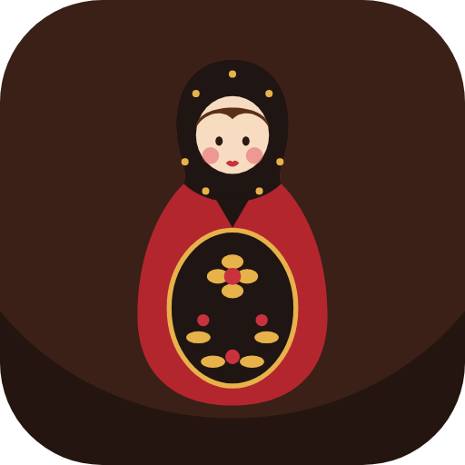
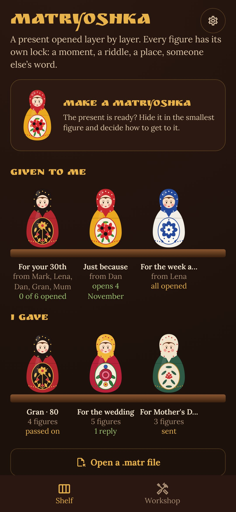
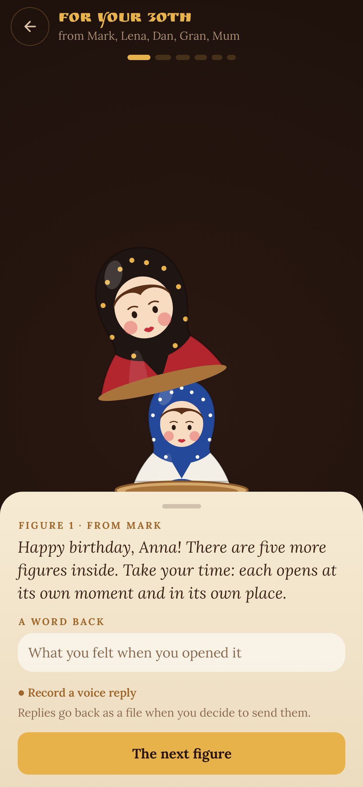
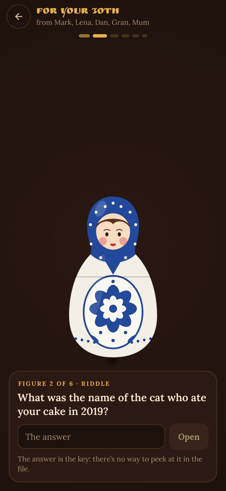
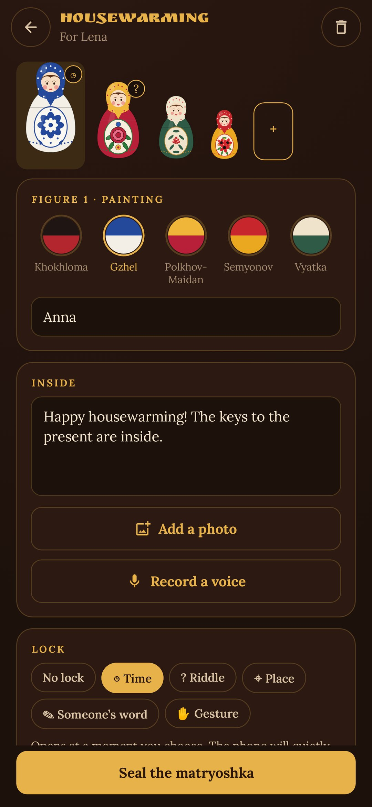

<div align="center">



# Matryoshka

### A present opened layer by layer

*The present itself sits in the smallest figure. Every figure around it has its own lock: a moment, a riddle, a place, a word someone else knows, a gesture. Make it on your own or pass it round friends and family, everyone painting one figure without seeing the others. It travels as one file in any messenger, and the riddles are real encryption. Free, no ads, no internet.*

[](https://github.com/bigdevwhale/matryoshka/actions/workflows/android.yml)


[](LICENSE)

**English** · [Русский](README.ru.md) · [Changelog](CHANGELOG.md)

   

**[Download the APK](https://github.com/bigdevwhale/matryoshka/releases/latest/download/Matryoshka.apk)** · Android 11+

</div>

---

## Figures and locks

- **Inside each figure**: a note, a photo, a voice, or all three. The smallest one is solid and holds the present, or where to look for it, or a link to the tickets.
- **Time**: opens on the birthday morning, or an hour after the last one. A quiet notification says when.
- **Riddle**: only the one it's for knows the answer. Case, «ё» and punctuation don't matter.
- **Place**: opens only within 50–300 m of the café where you met. Paste a Yandex or Google Maps link, coordinates, or stand there and tap "I'm here". The phone checks it itself.
- **Someone's word**: "ask your gran for the word". It drags the family into the quest.
- **Gesture**: cover it with a palm (the proximity sensor, or press and hold), shake it, put the phone face down.

The figure comes apart at the waist, and the next one is already peeking out.

## Together, without a server

- **A shared matryoshka** goes round as a file in a set order. Everyone paints one figure and sees the others only as dark silhouettes. The first one puts in the present; the last one seals it and sends it.
- **Replies.** The recipient can leave a few words or a voice note on each figure and send them back as a file. Open it, and the replies stand next to the matryoshka you gave.
- **The shelf**: everything given to you and everything you gave, painted in Khokhloma, Gzhel, Polkhov-Maidan, Semyonov and Vyatka.

## How the locks are kept

A `.matr` file is a zip: a cover anyone can read (paintings, names, questions, when and where) and encrypted pieces (AES-GCM). The outer figure's seed lies in the cover; each figure holds the seed of the next one. A figure's key is HMAC(seed, PBKDF2(answer)) for a riddle or a word, so the inner figures can't be opened without every outer one, and a riddle can't be opened without its answer, even with the file taken apart. Time, place and gesture are checked by the app. In a shared matryoshka, the pieces travel with their keys until the seal: they keep a glance out, not a determined giver.

No `INTERNET` permission. Location and the microphone are asked for only when a lock or a voice note needs them.

## Build

```
./gradlew assembleDebug                      # app.matryoshka.dev
./gradlew assembleDebug -Pdemo               # app.matryoshka.demo: a made-up shelf, pictures drawn in code
./gradlew testDebugUnitTest                  # the file format and the keys
./gradlew testDebugUnitTest -Prender --tests '*RenderScreens*' && python tools/shots.py   # screenshots
python tools/res.py                          # strings, EN and RU, from one table
python tools/icon.py                         # the launcher icon and small XML resources
```

Kotlin, Jetpack Compose, DataStore, WorkManager. Fonts: Ruslan Display, Lora (SIL OFL).

Part of [StillCraft](https://bigdevwhale.github.io/stillcraft/). MIT licence.
