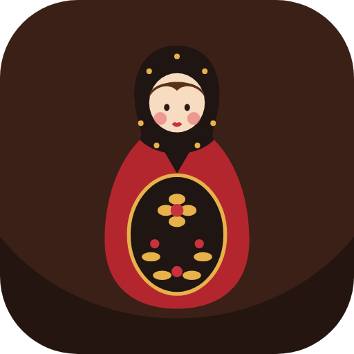
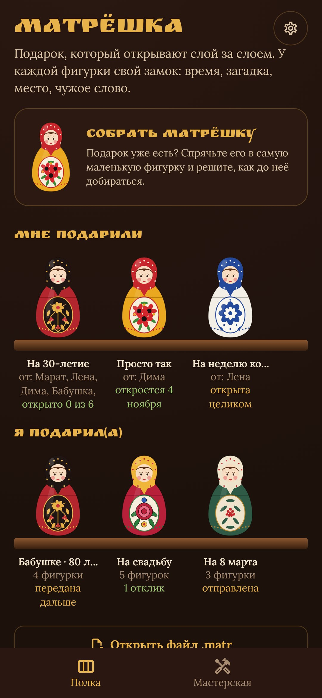
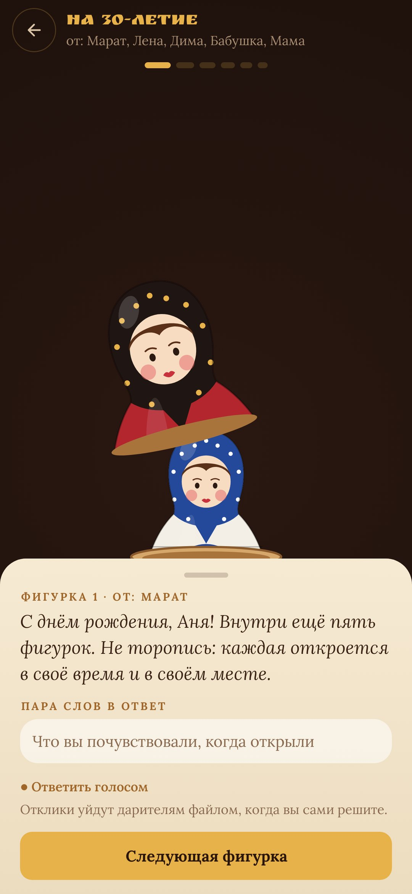
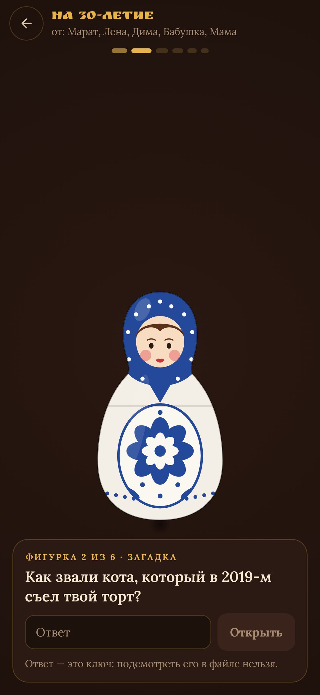
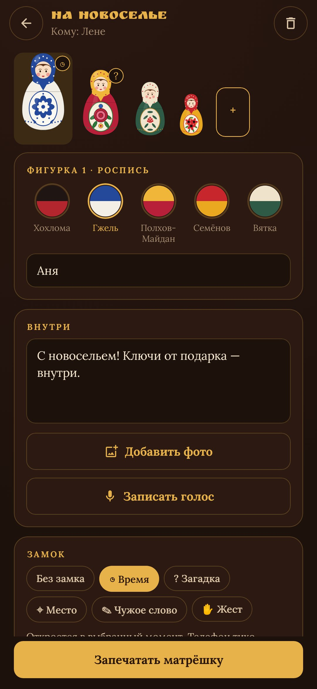

<div align="center">



# Матрёшка

### Подарок, который открывают слой за слоем

*Сам подарок лежит в самой маленькой фигурке. У каждой фигурки вокруг него свой замок: время, загадка, место, слово, которое знает другой человек, жест. Соберите матрёшку сами или пустите её по кругу среди друзей и родных: каждый распишет одну фигурку и не увидит чужих. Она путешествует одним файлом в любом мессенджере, а загадки — настоящее шифрование. Бесплатно, без рекламы, без интернета.*

[](https://github.com/bigdevwhale/matryoshka/actions/workflows/android.yml)


[](LICENSE)

[English](README.md) · **Русский** · [Изменения](CHANGELOG.md)

   

**[Скачать APK](https://github.com/bigdevwhale/matryoshka/releases/latest/download/Matryoshka.apk)** · Android 11+

</div>

---

## Фигурки и замки

- **Внутри каждой фигурки**: записка, фото, голос или всё сразу. Самая маленькая цельная, в ней сам подарок, или то, где его искать, или ссылка на билеты.
- **Время**: откроется утром в день рождения или через час после предыдущей. Тихое уведомление подскажет, когда пора.
- **Загадка**: ответ знает только тот, кому дарят. Регистр, «ё» и знаки препинания не важны.
- **Место**: откроется только в 50–300 м от кафе, где вы познакомились. Вставьте ссылку из Яндекс или Google Карт, координаты или просто встаньте там и нажмите «Я сейчас здесь». Телефон проверяет всё сам.
- **Чужое слово**: «Спроси кодовое слово у бабушки». В квест втягивается вся семья.
- **Жест**: накрыть ладонью (датчик приближения или долгое нажатие), потрясти, положить телефон экраном вниз.

Фигурка разнимается по поясу, а из неё уже выглядывает следующая.

## Вместе и без сервера

- **Общая матрёшка** идёт по кругу файлом в заданном порядке. Каждый расписывает одну фигурку, а чужие видит только тёмными силуэтами. Первый кладёт подарок, последний ставит печать и отправляет.
- **Отклики.** Получатель может оставить к каждой фигурке пару слов или голос и отправить их обратно файлом. Откройте его, и отклики встанут рядом с подаренной матрёшкой.
- **Полка**: всё, что подарили вам, и всё, что подарили вы, в росписях Хохломы, Гжели, Полхов-Майдана, Семёнова и Вятки.

## Как устроены замки

Файл `.matr` — это zip: обложка, которую может прочитать любой (росписи, имена, вопросы, когда и где), и зашифрованные части (AES-GCM). Зерно внешней фигурки лежит в обложке, а в каждой фигурке лежит зерно следующей. Ключ фигурки с загадкой или словом — HMAC(зерно, PBKDF2(ответ)). Поэтому внутренние фигурки не открыть, не открыв все внешние, а загадку не открыть без ответа, даже если разобрать файл. Время, место и жест проверяет приложение. В общей матрёшке до печати части путешествуют вместе с ключами: это защита от случайного взгляда, а не от упорного дарителя.

Разрешения `INTERNET` нет. Геолокацию и микрофон приложение просит, только когда они нужны замку или голосовой записке.

## Сборка

```
./gradlew assembleDebug                      # app.matryoshka.dev
./gradlew assembleDebug -Pdemo               # app.matryoshka.demo: придуманная полка, картинки нарисованы в коде
./gradlew testDebugUnitTest                  # формат файла и ключи
./gradlew testDebugUnitTest -Prender --tests '*RenderScreens*' && python tools/shots.py   # скриншоты
python tools/res.py                          # строки, EN и RU, из одной таблицы
python tools/icon.py                         # иконка и мелкие XML-ресурсы
```

Kotlin, Jetpack Compose, DataStore, WorkManager. Шрифты: Ruslan Display, Lora (SIL OFL).

Часть [StillCraft](https://bigdevwhale.github.io/stillcraft/). Лицензия MIT.
